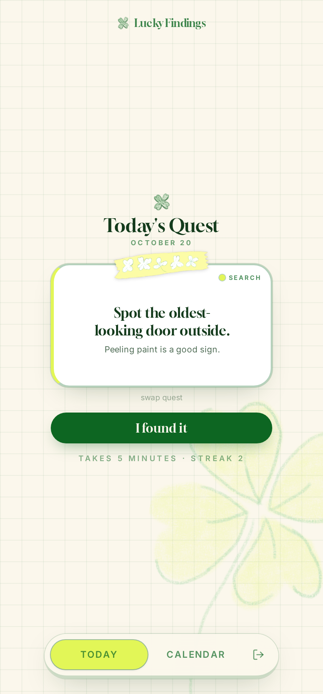

# Lucky Findings 🍀

*A little luck, once a day.*

Lucky Findings is a daily nature-quest app that gets you outside for five minutes. Each day it hands you a few tiny, creative quests — find a shape in the clouds, look through 20 clovers, follow whichever direction the wind is blowing — and asks you to snap a photo when you find one. Over time your photos pile up into a whimsical field journal: one polaroid per day you noticed something.



## How it works

1. **Open the app.** You get three fresh quests each day — no repeats of yesterday's, and no repeats of anything you've already done.
2. **Go outside and find it.** Every quest is designed to take less than 5 minutes and zero special equipment.
3. **Snap a photo.** The photo is your proof and your keepsake — it gets pinned to the calendar.
4. **Not feeling a quest? Swap it.** Two alternate options are offered every day, and if you've already completed one of the day's picks it's quietly replaced with something new.

Quests fall into five flavors, each with its own color-coded sticker:

| Category | What it asks of you |
| --- | --- |
| 🔍 **Search** | Find something rare among common things — a round pebble, a four-leaf clover |
| 👀 **Notice** | Pay attention to something that's always there — the first bird you hear |
| 🎲 **Serendipity** | Let luck pick — follow the wind, take a turn you've never taken |
| 🗣️ **Encounter** | A tiny human moment — ask someone for a small recommendation |
| ✋ **Make** | Five minutes of making — line leaves up lightest to darkest, build a stick arch |

The quest pool has 200+ prompts, so you won't run out of luck any time soon.

## Field journal

The calendar is the payoff: every completed day pins a little polaroid of your photo, your streak of luck grows, and days outside and total lucky finds are tallied up top.


## Privacy

Your photos, findings, captions, and the invite list all live in the app's database — **not** in this code. Only signed-in users can see them, and sign-up is invite-only (allowlisted emails). The only key present in the code is the publishable one, which is safe to expose and can't get past sign-in.

## Tech stack

- **[TanStack Start](https://tanstack.com/start)** — React 19, file-based routing, server functions
- **Tailwind CSS v4** with a hand-rolled design system (butter, lime, forest, sky, pink on a paper-grid background)
- **Gloock** for display type, **Inter** for body text
- **Lovable Cloud (Supabase)** for auth, data, and photo storage
- Hand-drawn badges, icons, and washi-tape strips by the founder 🎨

## Running it yourself

```bash
bun install
bun run dev
```

You'll need a Lovable Cloud backend configured (auth + `findings` table + storage bucket) — the easiest way is to remix or connect this project on [Lovable](https://lovable.dev), which wires that up for you.

Sign-in is email OTP, gated by an allowlist, so nobody outside the invite list gets in.

## Credits

Design, drawings, and quests by [Priscilla Pan](https://www.instagram.com/priscilla.png/). Built with Lovable.
